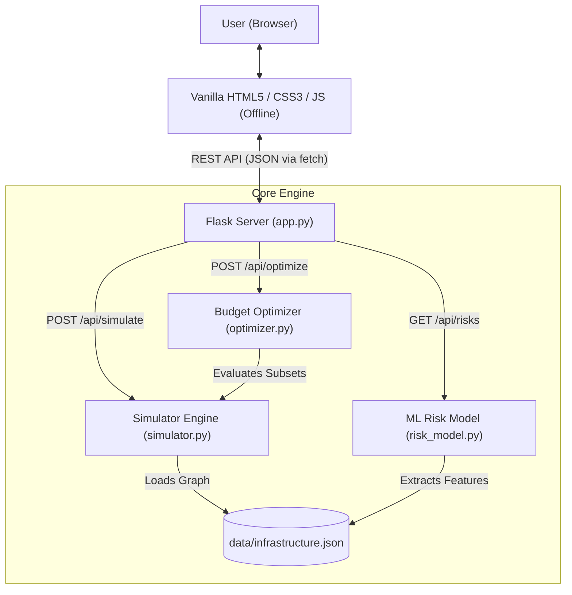

# AFTERSHOCK AI
### AI-Based Cascading Infrastructure Failure Simulator with Budget-Aware Resilience Planning

**AFTERSHOCK AI** is an academic hackathon prototype and educational simulation environment designed for computer science and engineering students, faculty mentors, and disaster-resilience researchers. It models how catastrophic shocks to critical municipal infrastructure (e.g., electricity substations, water pumping stations, hospitals, communication towers, and arterial roads) trigger multi-order cascading disruptions across interconnected services. Furthermore, it implements an exact combinatorial knapsack optimizer to recommend budget-constrained protective interventions (in Indian Rupees, ₹) that maximize municipal resilience, coupled with a reproducible Scikit-learn Random Forest classifier demonstrating an AI/ML risk categorization workflow.

---

> **ACADEMIC & EDUCATIONAL DISCLAIMER**  
> **AFTERSHOCK AI is strictly an educational simulation and research demonstration prototype.**  
> It uses programmatic synthetic data, illustrative economic costs, and simplified dependency assumptions. It is **NOT** a certified disaster prediction tool, hydraulic/electrical grid engineering model, or emergency decision-support system. It must **NEVER** be used to make real-world evacuation, healthcare triage, or municipal civil defense decisions.

---

## Table of Contents
1. [Problem Statement](#1-problem-statement)
2. [Project Objectives](#2-project-objectives)
3. [Intended Users](#3-intended-users)
4. [Technology Stack](#4-technology-stack)
5. [Project Directory Structure](#5-project-directory-structure)
6. [System Architecture](#6-system-architecture)
7. [Infrastructure Network Model & Dependencies](#7-infrastructure-network-model--dependencies)
8. [Disaster Hazard Scenarios](#8-disaster-hazard-scenarios)
9. [Cascading Failure Simulation Algorithm](#9-cascading-failure-simulation-algorithm)
10. [Disruption Score Formula](#10-disruption-score-formula)
11. [Protective Interventions & Costs (₹ INR)](#11-protective-interventions--costs--inr)
12. [Budget Optimization Algorithm](#12-budget-optimization-algorithm)
13. [Demonstration Machine Learning Workflow](#13-demonstration-machine-learning-workflow)
14. [Frontend-Backend Communication & REST API Documentation](#14-frontend-backend-communication--rest-api-documentation)
15. [Windows and Visual Studio Code Installation Guide](#15-windows-and-visual-studio-code-installation-guide)
16. [Offline Operation Instructions](#16-offline-operation-instructions)
17. [Automated Testing](#17-automated-testing)
18. [Manual Frontend Testing Checklist](#18-manual-frontend-testing-checklist)
19. [Troubleshooting Guide](#19-troubleshooting-guide)
20. [Academic Assumptions & Limitations](#20-academic-assumptions--limitations)
21. [Security & Reliability Considerations](#21-security--reliability-considerations)
22. [Future Improvements](#22-future-improvements)

---

## 1. Problem Statement

Modern cities depend on tightly interconnected systems of lifelines:
- **Electricity Substations** supply power to water pumps, hospitals, and cellular antennas.
- **Water Pump Stations** pressurize drinking water and deliver essential supplies for hospital sterilization and relief shelters.
- **Hospitals** require continuous electricity, potable water, medical telemetry, and physical road access to treat patients.
- **Communication Towers** relay 911 dispatch calls and telemetry between first responders and command centers.
- **Main Access Roads** allow ambulances, fire engines, evacuees, and emergency supplies to navigate the city.

When one asset fails during a disaster (e.g., a transformer explodes or a river breaches its embankment), conventional single-sector models fail to capture the domino effect:
1. An initial shock disables the electricity substation.
2. The water pump station loses power and stops pumping.
3. The communication tower loses mains power and halts emergency dispatch.
4. The hospital loses water pressure and communications, quickly followed by physical road cutoff.

City planners and emergency agencies operate under **strict fiscal constraints**. They cannot afford to reinforce every facility simultaneously. **AFTERSHOCK AI** solves this challenge by simulating cascading failure propagation and computationally identifying the optimal combination of protective interventions achievable within a user-defined budget.

---

## 2. Project Objectives

1. **Model an Interconnected Network:** Predefine municipal assets with directed dependencies, criticality ratings, and hazard exposures.
2. **Deterministic Cascade Simulation:** Track multi-wave failure cascades using Breadth-First Search (BFS) graph traversal.
3. **Multi-Hazard Scenarios:** Implement selectable scenarios (Flood, Power Outage, Communication Failure).
4. **Resilience Disruption Score:** Formulate an objective, deterministic disruption metric based on asset criticality.
5. **Exact Budget-Constrained Optimization:** Evaluate candidate intervention subsets to maximize disruption reduction within an INR (₹) budget.
6. **Machine Learning Demonstration:** Train a local Scikit-learn `RandomForestClassifier` on reproducible synthetic data to classify static asset risk tiers.
7. **Strict Offline Operation:** Zero external CDNs, cloud APIs, external fonts, or live web calls. All CSS, vanilla JS, SVG icons, and charts run completely offline.
8. **Automated & Manual Verification:** Comprehensive test suite with 43 automated unit/integration tests and step-by-step manual testing protocol.

---

## 3. Intended Users

- **Third-Year Computer Science and Engineering Students:** Learning graph algorithms (BFS/queues), combinatorial optimization, REST API design, and scikit-learn ML workflows.
- **Hackathon Judges & Academic Evaluators:** Inspecting clean, modular code, documented mathematical formulations, and interactive visualizations.
- **Civil & Municipal Resilience Researchers:** Exploring conceptual proof-of-concept cascade models before investing in heavy industrial simulation tools.

---

## 4. Technology Stack

### Frontend
- **HTML5:** Semantic, accessible layout.
- **CSS3:** Dark-mode municipal command center theme, responsive CSS Grid and Flexbox, custom status badges.
- **Vanilla JavaScript (ES6+):** Pure JavaScript using the native `fetch()` API for client-server communication.
- **Native HTML/CSS/SVG Visualizations:** Custom directed SVG dependency graph and pure CSS bar chart. **Zero external chart CDNs (e.g. Chart.js) or font CDNs.**

### Backend
- **Python 3.10+ / 3.11+**
- **Flask (>= 3.0.0):** Lightweight WSGI web framework serving static single-page assets and JSON REST APIs.
- **Built-in Python Modules:** `json`, `math`, `os`, `sys`, `copy`, `unittest`.

### AI/ML
- **Scikit-learn (>= 1.3.0):** `RandomForestClassifier` with a fixed random seed (`random_state=42`).
- **NumPy (>= 1.24.0):** Vectorized synthetic feature generation.

### Data Storage
- **Local JSON:** `data/infrastructure.json` for assets, directed dependencies, disaster scenarios, and intervention catalogs.

---

## 5. Project Directory Structure

```text
AFTERSHOCK_AI/
│
├── app.py                     # Flask REST API backend and static file server
├── simulator.py               # BFS cascading failure graph simulation engine
├── optimizer.py               # Combinatorial budget-constrained knapsack optimizer
├── risk_model.py              # Scikit-learn Random Forest risk classifier (synthetic data)
├── requirements.txt           # Python dependency definitions
├── README.md                  # Comprehensive technical documentation & setup guide
│
├── data/
│   └── infrastructure.json    # Authoritative asset catalog, dependencies, scenarios, interventions
│
├── static/
│   ├── simulation.html        # Primary Simulation interface
│   ├── infrastructure.html    # Asset catalog and dependencies
│   ├── optimizer.html         # Budget optimization
│   ├── risks.html             # Risk classifications
│   ├── style.css              # Offline command-center styles
│   └── script.js              # Vanilla JS frontend state manager, SVG graph, and chart renderer
│
└── tests/
    ├── __init__.py            # Test package initializer
    ├── test_simulator.py      # Tests for JSON integrity, initial shock, and BFS cascade rules
    ├── test_optimizer.py      # Tests for budget constraints, edge cases, and disruption reduction
    ├── test_risk_model.py     # Tests for ML model initialization, reproducibility, and feature validation
    └── test_api.py            # Flask test-client tests for all HTTP REST API endpoints
```

---

## 6. System Architecture



### Separation of Concerns:
1. **Rule-Based Cascading Simulator (`simulator.py`):** Authoritative, deterministic propagation of prerequisite loss using graph traversal.
2. **Combinatorial Optimizer (`optimizer.py`):** Exact mathematical knapsack evaluation seeking optimal resilience investments.
3. **Machine Learning Classifier (`risk_model.py`):** Distinct statistical classification demonstrating multi-attribute risk tiering.

---

## 7. Infrastructure Network Model & Dependencies

The system models **8 municipal infrastructure facilities** (including the 5 required core assets):

| Asset ID | Human-Readable Name | Category | Criticality (1-10) | Prerequisite Dependencies (`depends_on`) |
| :--- | :--- | :--- | :---: | :--- |
| `substation` | **Electricity Substation** | Energy | 10 | *None (Primary High-Voltage Grid Source)* |
| `water` | **Water Pump Station** | Water Supply | 8 | `substation` |
| `hospital` | **Hospital** | Healthcare | 10 | `substation`, `water`, `tower`, `road` |
| `tower` | **Communication Tower** | Telecommunications | 7 | `substation` |
| `road` | **Main Access Road** | Transportation | 8 | *None (Primary Ground Transit Artery)* |
| `emergency` | **Emergency Control Centre** | Emergency Services | 9 | `substation`, `tower`, `road` |
| `shelter` | **Relief Shelter** | Public Safety | 7 | `water`, `road` |
| `treatment` | **Water Treatment Facility** | Water Supply | 6 | `substation`, `water` |

**Total Network Criticality:** $10 + 8 + 10 + 7 + 8 + 9 + 7 + 6 = 65\text{ points}$.

### Directed Dependency Meaning:
An edge $A \rightarrow B$ signifies that **Asset B depends on Asset A**. If Asset A fails, Asset B loses an essential operating input and will fail in the subsequent cascade wave unless an active intervention protects it.

---

## 8. Disaster Hazard Scenarios

### Scenario A: Severe Flood & Road Washout (`flood`)
- **Initiating Hazard:** Extreme monsoon downpour causes river embankment overflow.
- **Initial Failures:** `substation` (submerged switchgear) and `road` (arterial washout).
- **Cascading Consequences:**
  - Water pump, communication tower, and water treatment lose power.
  - Hospital loses power, water, communication, and ambulance road access.
  - Emergency center and relief shelter become isolated and lose essential utilities.
- **Unprotected Outcome:** Complete cascade failure across all 8 assets (Disruption Score: **65 / 65**).

### Scenario B: Power Grid Transformer Collapse (`power_outage`)
- **Initiating Hazard:** Extreme summer heatwave and grid overload explode the main step-down transformer.
- **Initial Failure:** `substation`.
- **Cascading Consequences:**
  - Water pump, communication tower, and water treatment stop operating.
  - Hospital and emergency center lose grid power and municipal water.
  - **Main Access Road remains operational** (roads do not require electricity to exist).
- **Unprotected Outcome:** 7 assets fail, 1 asset (`road`) remains operational (Disruption Score: **57 / 65**).

### Scenario C: Telecommunications Mast Collapse (`communication_failure`)
- **Initiating Hazard:** Localized cyclonic wind gust shears the main transceiver mast and severs fiber trunk lines.
- **Initial Failure:** `tower`.
- **Cascading Consequences:**
  - Hospital and Emergency Center lose emergency telemetry and 911 dispatch lines.
  - **Substation, water pump, treatment plant, shelter, and road remain operational** because their physical mechanics do not depend on wireless telecom.
- **Unprotected Outcome:** 3 assets fail (`tower`, `hospital`, `emergency`), 5 assets remain operational (Disruption Score: **26 / 65**).

---

## 9. Cascading Failure Simulation Algorithm

The simulation in [`simulator.py`](file:///C:/Users/vijit/OneDrive/Desktop/Pooja/AFTERSHOCK_AI-/simulator.py) operates deterministically using Breadth-First Search (BFS):

```text
Algorithm CascadingFailureSimulation(Scenario S, Interventions P):
  1. Load infrastructure graph G = (V, E)
  2. Identify Initial Hazard Assets from S
  3. Filter Initial Shocks:
       For each asset A in Initial Hazard Assets:
         If A has active hazard-defense intervention in P matching S:
           Mark A as Safeguarded
         Else:
           Mark A as Failed; Enqueue A into Queue Q
  4. Initialize Round = 1, Visited = set(Failed)
  5. While Q is not empty:
       Current_Layer = dequeue all elements from Q
       For each failed asset F in Current_Layer:
         For each dependent target T where (F -> T) in E:
           If T not in Visited:
             Lost_Dependencies = { prerequisites of T that are in Visited }
             If T has active backup intervention in P mitigating Lost_Dependencies:
               Mark T as Protected / Backed-up
             Else:
               Mark T as Failed
               Add T to Visited
               Enqueue T into Q for next cascade round
       Increment Round
  6. Compute Disruption Score = Sum(criticality of all assets in Visited)
  7. Return Structured Simulation Report (Assets, Rounds, Timeline, Disruption Score)
```

### Loop and Cycle Protection
Because real-world systems might have cyclic dependencies (e.g., control center controls power, power runs control center), the algorithm maintains a strict `Visited` set. Assets can transition from operational to failed **at most once**, preventing infinite loops and duplicate event logging.

---

## 10. Disruption Score Formula

The Disruption Score is a deterministic, additive metric representing aggregate municipal functional loss:

$$\text{Disruption Score} = \sum_{a \in \mathcal{F}} \text{Criticality}(a)$$

Where:
- $\mathcal{F}$ is the set of all assets failed at the conclusion of the cascade.
- $\text{Criticality}(a) \in [1, 10]$ is the predefined importance rating of asset $a$.

### Comparative Metrics:
$$\text{Absolute Disruption Reduction} = \text{Disruption}_{\text{baseline}} - \text{Disruption}_{\text{protected}}$$

$$\text{Percentage Reduction} = \begin{cases} 
\left( \frac{\text{Absolute Reduction}}{\text{Disruption}_{\text{baseline}}} \right) \times 100\% & \text{if } \text{Disruption}_{\text{baseline}} > 0 \\ 
0\% & \text{if } \text{Disruption}_{\text{baseline}} = 0 
\end{cases}$$

---

## 11. Protective Interventions & Costs (₹ INR)

All costs are defined in [`data/infrastructure.json`](file:///C:/Users/vijit/OneDrive/Desktop/Pooja/AFTERSHOCK_AI-/data/infrastructure.json) in Indian Rupees (₹):

| Intervention ID | Name | Target Asset | Illustrative Cost (₹) | Mechanism | Applicable Hazards |
| :--- | :--- | :--- | :---: | :--- | :--- |
| `INT-SUB` | **Substation Flood Protection** | `substation` | ₹35,000 | Physical concrete flood walls and submersible pumps | `flood` |
| `INT-ROD` | **Alternative Road Access** | `road` | ₹25,000 | Elevated secondary bypass and reinforced culverts | `flood` |
| `INT-WTR` | **Water Pump Backup** | `water` | ₹15,000 | On-site industrial diesel generator & transfer switch | `power_loss` |
| `INT-COM` | **Communication Tower Backup** | `tower` | ₹20,000 | High-capacity battery array & hardened antennas | `all` |
| `INT-HSP` | **Hospital Backup Power** | `hospital` | ₹30,000 | Emergency diesel microgrid & on-site water cistern | `utility_outage` |
| `INT-EMG` | **Emergency Centre Auxiliary Power** | `emergency` | ₹18,000 | Standby generator and satellite communication link | `all` |

---

## 12. Budget Optimization Algorithm

The optimizer in [`optimizer.py`](file:///C:/Users/vijit/OneDrive/Desktop/Pooja/AFTERSHOCK_AI-/optimizer.py) solves the budget-constrained multi-objective knapsack problem.

### Decision Model:
$$\min_{P \subseteq \mathcal{I}} \quad \langle \text{Disruption}(S, P), \quad \text{Cost}(P), \quad |P| \rangle$$

$$\text{subject to} \quad \text{Cost}(P) \le \text{Budget}$$

Where:
- $\mathcal{I}$ is the set of 6 available interventions ($|\mathcal{I}| = 6$).
- $2^6 = 64$ candidate subsets are evaluated exhaustively.
- The lexicographical ordering guarantees:
  1. First priority: **Minimize final disruption score**.
  2. Second priority (tie-breaker): **Minimize total expenditure (conserve rupees)**.
  3. Third priority (tie-breaker): **Minimize number of active projects (minimize operational overhead)**.

### Practicality Note:
Exhaustive evaluation is fast ($< 15\text{ ms}$) because $N = 6$. For industrial networks with $N \ge 30$, exact search is NP-hard, and integer programming (Branch and Bound) or meta-heuristics (Genetic Algorithms) are required.

---

## 13. Demonstration Machine Learning Workflow

Implemented in [`risk_model.py`](file:///C:/Users/vijit/OneDrive/Desktop/Pooja/AFTERSHOCK_AI-/risk_model.py):

- **Model:** Scikit-learn `RandomForestClassifier(n_estimators=60, max_depth=5, random_state=42)`.
- **Reproducibility:** A fixed random seed (`seed=42`) ensures 100% reproducible training outputs across runs.
- **Input Features (4 Attributes):**
  1. `criticality` (1 - 10)
  2. `exposure_score` (1 - 10 hazard index)
  3. `dependency_count` (number of upstream prerequisites)
  4. `redundancy_level` (0 = none, 1 = partial, 2 = full)
- **Output Classes:**
  - `Low Demonstration Risk`
  - `Medium Demonstration Risk`
  - `High Demonstration Risk`
- **Output Confidence:** Normal class probability distribution from the ensemble trees.

---

## 14. Frontend-Backend Communication & REST API Documentation

All API routes communicate using JSON over HTTP.

### Endpoints:

#### 1. `GET /`
Serves the offline single-page application from `static/index.html`.

#### 2. `GET /api/status`
Health check and environment status.
```json
{
  "status": "online",
  "project": "AFTERSHOCK AI",
  "demonstration_mode": true,
  "offline_ready": true,
  "version": "2.0.0"
}
```

#### 3. `GET /api/infrastructure`
Returns metadata, all 8 assets, and 13 directed dependency edges.

#### 4. `GET /api/scenarios`
Returns the 3 configured disaster hazard scenarios.

#### 5. `GET /api/interventions`
Returns the catalog of 6 interventions with costs in ₹ INR.

#### 6. `GET /api/risks`
Returns Random Forest risk classifications and synthetic data warning for all assets.

#### 7. `POST /api/simulate`
Executes cascading failure simulation.
- **Request:**
  ```json
  {
    "scenario": "flood",
    "protected_assets": ["INT-SUB", "INT-ROD"]
  }
  ```
- **Response:** HTTP 200 with disruption score, timeline, and asset statuses.

#### 8. `POST /api/optimize`
Solves the budget knapsack problem.
- **Request:**
  ```json
  {
    "scenario": "flood",
    "budget": 50000
  }
  ```
- **Response:** HTTP 200 with recommended interventions, total cost, remaining budget, and simulated reduction.

---

## 15. Windows and Visual Studio Code Installation Guide

Follow these exact steps on Windows:

### Step 1: Open the Project Folder in VS Code
1. Launch **Visual Studio Code**.
2. Click **File → Open Folder...** (or press `Ctrl + K, Ctrl + O`).
3. Select the extracted `AFTERSHOCK_AI` folder.
4. Ensure the VS Code Explorer shows `app.py`, `simulator.py`, `data/`, and `static/` at the root.

### Step 2: Open the Integrated Terminal
1. In VS Code, go to the top menu: **Terminal → New Terminal** (or press `` Ctrl + ` ``).
2. Verify you are in the project root by running:
   ```powershell
   Get-Location
   ```

### Step 3: Install Required Dependencies
Run the following command in PowerShell:
```powershell
python -m pip install -r requirements.txt
```
*(Requires internet during this initial install to fetch Flask, scikit-learn, and numpy from PyPI).*

### Step 4: Run Automated Tests
Before starting the server, verify the test suite:
```powershell
python -m unittest discover -s tests -p "test_*.py" -v
```
You should see all tests pass.

### Step 5: Start the Local Flask Server
```powershell
python app.py
```
The server prints the selected Simulation URL. If port 5000 is occupied, it automatically tries the next available port:
```text
Website: http://127.0.0.1:<selected-port>/simulation
```

### Step 6: Open the Simulation Page
Open the Website URL printed in the server terminal. Use the same selected port when opening the other pages.

### Step 7: Stop the Server
When finished, return to the VS Code terminal and press `Ctrl + C`.

---

## 16. Offline Operation Instructions

AFTERSHOCK AI is engineered from the ground up for **100% offline resilience**:
1. Complete initial setup (Step 3 above) while connected to install packages.
2. **Disconnect your laptop from Wi-Fi and unplug your Ethernet cable.**
3. Run `python app.py` in your terminal.
4. Open the Website URL printed by `python app.py` in your browser.
5. All icons (inline SVG), styling (local CSS), simulation logic (local Python), and charts (native CSS bar chart) will render without requiring any internet connection.

---

## 17. Automated Testing

Run the test suite using Python's built-in `unittest` runner:

```powershell
python -m unittest discover -s tests -p "test_*.py" -v
```

### Test Coverage Summary:
- **`tests/test_simulator.py` (17 tests):** JSON schema, asset IDs uniqueness, required 5 core assets, dependency validity, BFS cascade correctness, protection specificity, cycle safety.
- **`tests/test_optimizer.py` (9 tests):** Zero budget, negative budget rejection, NaN/Inf rejection, boolean rejection, budget constraint enforcement, exact mathematical reductions, insufficient budget handling.
- **`tests/test_risk_model.py` (6 tests):** Model initialization, fixed-seed reproducibility, supported labels, feature validation, synthetic notice.
- **`tests/test_api.py` (11 tests):** HTTP status codes, JSON response formats, input validation, 400 error handling, 404 handler.

---

## 18. Manual Frontend Testing Checklist

| Step | Action | Expected Result |
| :---: | :--- | :--- |
| **1** | Open the Website URL printed by `python app.py` | Simulation page loads and prompts for a city selection. |
| **2** | Inspect offline operation | Disconnect Wi-Fi; page remains fully functional without console network errors. |
| **3** | Select **Flood** scenario & click **Run Baseline Simulation** | Baseline score displays **65**. Timeline populates with 8 events. All 8 nodes show red/failed. |
| **4** | Select **Power Grid Failure** & run baseline | Baseline score displays **57**. Road remains green/operational. |
| **5** | Select **Communication Failure** & run baseline | Baseline score displays **26**. Tower, Hospital, and Emergency fail; other 5 assets stay operational. |
| **6** | Return to **Flood**, enter budget `₹50000`, click **Find Budget Plan** | Recommends `Substation Flood Protection` (₹35k) + `Water Pump Backup` (₹15k). Cost: ₹50,000, Left: ₹0. Projected score: 26. |
| **7** | Click **Apply Plan** | Asset states update. Hospital and Shelter remain operational. Before-versus-after chart stays visible and compares 65 vs 26. |
| **8** | Test zero budget (`₹0`) | Plan reports ₹0 cost, 0 reduction, and provides an honest explanation that ₹0 cannot afford interventions. |
| **9** | Test insufficient budget (`₹5000`) | Reports budget is below minimum required intervention (₹15,000). |
| **10** | Click **Dependency Graph** tab | Interactive SVG graph displays with directed arrows. Clicking any node updates the Inspector card with prerequisites. |
| **11** | Click **ML Risk Assessment** tab | Displays all 8 asset cards with Random Forest risk tiers (Low/Medium/High) and prominent synthetic warning. |
| **12** | Click **Model Assumptions & Limitations** tab | Displays the 12 explicit academic limitations. |

---

## 19. Troubleshooting Guide

### `ModuleNotFoundError: No module named 'flask'` (or `'sklearn'`)
- **Cause:** Dependencies were installed in a different Python environment or terminal.
- **Fix:** In VS Code, press `Ctrl + Shift + P` → **Python: Select Interpreter** → choose your active Python installation. Then rerun:
  ```powershell
  python -m pip install -r requirements.txt
  ```

### `FileNotFoundError: Infrastructure data file not found`
- **Cause:** Running `python app.py` from outside the project root directory.
- **Fix:** Ensure your terminal prompt is in the `AFTERSHOCK_AI` folder where `app.py` is located. Check with `Get-Location` and navigate with `cd AFTERSHOCK_AI`.

### `404 Not Found` in Browser
- **Cause:** Typo in the URL or accessing an unimplemented route.
- **Fix:** Verify you are using the page URL printed by the current Flask process. An older server may still be using port 5000.

### `ERR_CONNECTION_REFUSED`
- **Cause:** Flask backend is not running or crashed.
- **Fix:** Check the VS Code terminal. If the prompt is visible, run `python app.py` and open the selected URL printed there.

### Port 5000 Conflict
- **Cause:** Another background process or previous server is occupying port 5000.
- **Fix:** `python app.py` automatically tries the next available local port and prints the correct page URLs. Open the printed URL, not a URL from an older server session. To choose a preferred starting port, set `AFTERSHOCK_PORT` before launch.

### Command-Line API Testing (PowerShell Examples)
You can test the REST API directly using PowerShell `Invoke-RestMethod`:

```powershell
$baseUrl = "http://127.0.0.1:5000" # replace 5000 with the selected port printed at startup

# 1. Health check
Invoke-RestMethod -Uri "$baseUrl/api/status" -Method GET

# 2. Run simulation
$body = @{ scenario = "flood"; protected_assets = @("INT-SUB") } | ConvertTo-Json
Invoke-RestMethod -Uri "$baseUrl/api/simulate" -Method POST -Body $body -ContentType "application/json"

# 3. Find optimal budget plan
$optBody = @{ scenario = "flood"; budget = 50000 } | ConvertTo-Json
Invoke-RestMethod -Uri "$baseUrl/api/optimize" -Method POST -Body $optBody -ContentType "application/json"
```

---

## 20. Academic Assumptions & Limitations

1. **Synthetic Data:** No real-world telemetry or confidential utility schematics are used. All parameters are illustrative placeholders.
2. **Simplified Dependencies:** Real infrastructure involves hydraulic pressure gradients, electrical phase angles, and physical line impedances not captured by binary directed edges.
3. **Unvalidated Machine Learning:** The Random Forest classifier is trained on programmatic synthetic samples to teach the ML workflow. It does not reflect verified disaster records.
4. **Illustrative Costs:** Intervention costs in ₹ INR are estimates for hackathon ranking and do not reflect audited contractor estimates.
5. **Optimization Scope:** Exhaustive subset search ($2^6 = 64$) works only for small networks and does not scale to multi-thousand asset power grids without integer programming.
6. **No Live Telemetry:** The application does not interface with live SCADA or IoT sensors.
7. **Offline Boundaries:** Offline execution cannot pull live weather radar maps.
8. **Host Power Dependency:** Requires an operational host computer with continuous electrical power.
9. **Discrete Scenarios:** Models discrete shock states rather than continuous temporal weather patterns.
10. **Simplified Uncertainty:** Does not model repair logistics, spare part supply chains, or human operator stress.
11. **No Emergency Authority:** Must not be used for municipal command or evacuation decisions.
12. **Educational Purpose:** Built as an academic demonstration for computer science and engineering coursework.

---

## 21. Security & Reliability Considerations

- **Strict Input Validation:** Rejects negative budgets, non-finite values (NaN, Inf), and boolean types.
- **Path Traversal Protection:** All file paths are constructed using `os.path.join` relative to the application root directory.
- **Cycle-Safe BFS:** The simulation maintains a visited set to guarantee termination on cyclic graphs.
- **Debug Mode Disabled:** Flask runs with `debug=False` by default to avoid arbitrary code execution vulnerabilities.
- **Safe DOM Manipulation:** Frontend uses `textContent` and an `escapeHtml()` sanitizer to prevent Cross-Site Scripting (XSS).

---

## 22. Future Improvements

1. **Multi-State Degraded Operations:** Extend asset states beyond binary (Operational/Failed) to include partial capacity (e.g., 50% brownout).
2. **Time-Dependent Dynamic Restoration:** Model repair crews, restoration time curves, and priority dispatching over a multi-day timeline.
3. **Integer Linear Programming (ILP):** Integrate `scipy.optimize.milp` to scale budget optimization to networks with hundreds of assets.
4. **Geographic GIS Mapping:** Bundle offline GeoJSON layers with Leaflet for spatial layout visualization.

---

**Developed for the Academic Hackathon by the AFTERSHOCK AI Engineering Team.**

